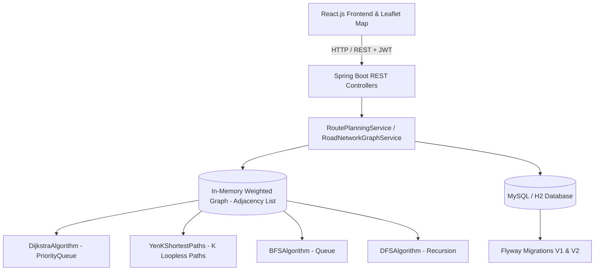

# Emergency Vehicle Route Planner & Hospital Proximity System
### Data Structures & Algorithms Navigation Network

A full-stack emergency response navigation and route planning platform powered by custom Data Structures and Algorithms (DSA), Spring Boot 3, Leaflet OpenStreetMap, and React.js.

The system models urban road networks as a weighted, directed graph and solves shortest path routing in real time for emergency ambulances, fire trucks, and rescue squads navigating across the authentic road corridors of Hyderabad.

---

## 🌟 Key Features

1. **Incident-Centric Nearby Hospitals Detection**:
   - Emergency dispatchers select an incident location (e.g., *Cyber Towers Junction*, *Punjagutta Circle*, *Mehdipatnam*, *Jubilee Hills Checkpost*).
   - The system automatically evaluates graph proximity to all apex trauma centers in Hyderabad using **Dijkstra's Shortest Path Algorithm** and min-heap **Priority Queue**.
   - Ranks hospitals by emergency transit proximity (km and minutes), highlights the `#1 Closest Hospital`, and immediately plots the route on the map.
   - If starting and destination points ever coincide, the system automatically detects this and gracefully routes to the nearest trauma hospital.

2. **Authentic Hyderabad Emergency Network**:
   - **8 Apex Trauma Hospitals**:
     - *NIMS Hospital (Nizams Institute)*, Punjagutta (Level 1 Trauma, 60 ICU Beds)
     - *Apollo Health City*, Jubilee Hills (Level 1 Trauma, 50 ICU Beds)
     - *Medicover Hospitals*, HITEC City (Level 2 Trauma, 40 ICU Beds)
     - *AIG Hospitals*, Gachibowli (Level 1 Trauma, 55 ICU Beds)
     - *Care Hospital*, Banjara Hills Road No. 1 (Level 2 Trauma, 35 ICU Beds)
     - *Yashoda Hospital*, Secunderabad (Level 1 Trauma, 45 ICU Beds)
     - *Gandhi Hospital*, Musheerabad (Level 1 Trauma, 70 ICU Beds)
     - *Osmania General Hospital*, Afzal Gunj (Level 1 Trauma, 65 ICU Beds)
   - **Key Junctions & Arterials**: Cyber Towers Roundabout, Begumpet Airport Road Flyover, Durgam Cheruvu Cable Bridge Expressway, Masab Tank, Lakdi-ka-pul, Charminar Heritage Crossing, etc.
   - **Simulated Closures**: PVNR Elevated Expressway Ramp marked as `CLOSED` to verify real-time bypass capabilities.

3. **Core DSA Implementations**:
   - **Dijkstra's Algorithm**: Min-heap `PriorityQueue` solving shortest path in $O((V + E) \log V)$ time with $O(V)$ auxiliary space.
   - **Yen's K-Shortest Loopless Paths Algorithm**: Computes spur paths and provides up to $k$ distinct alternative corridors.
   - **Breadth-First Search (BFS)**: Level-by-level radial reachability and hop analysis in $O(V + E)$.
   - **Depth-First Search (DFS)**: Recursive back-tracking connectivity and cycle detection in $O(V + E)$.

4. **Dynamic Road Network Graph Management**:
   - Dispatchers and admins can toggle road status (`OPEN` $\leftrightarrow$ `CLOSED`) dynamically.
   - Graph edges are updated in memory without restarting the server, instantly recalculating emergency routes around blockages.

5. **Compact & User-Friendly UI**:
   - Responsive Leaflet OpenStreetMap centered over Hyderabad with 420px height for optimal dashboard layout.
   - Interactive markers with 1-click incident spot selection and hospital routing.
   - Turn-by-turn road segment breakdowns and DSA complexity inspection.

---

## 🏗️ System Architecture



---

## 📊 DSA Time & Space Complexity

| Algorithm | Data Structure | Time Complexity | Auxiliary Space | Use Case |
| :--- | :--- | :--- | :--- | :--- |
| **Dijkstra's Shortest Path** | Adjacency List + Min-Heap `PriorityQueue` | $\mathcal{O}((V + E) \log V)$ | $\mathcal{O}(V)$ | Optimal emergency route calculation |
| **Yen's K-Shortest Paths** | Deviation Graph + Candidate Min-Heap | $\mathcal{O}(K \cdot V \cdot (V + E) \log V)$ | $\mathcal{O}(K \cdot V)$ | Alternative loopless detour planning |
| **Breadth-First Search (BFS)** | Adjacency List + FIFO `Queue` | $\mathcal{O}(V + E)$ | $\mathcal{O}(V)$ | Radial reachability from incident node |
| **Depth-First Search (DFS)** | Adjacency List + Recursion Stack | $\mathcal{O}(V + E)$ | $\mathcal{O}(V)$ | Graph connectivity & subnet exploration |

---

## 🚀 Getting Started

### Prerequisites
- **Java**: JDK 17 or higher (tested with JDK 24)
- **Maven**: Version 3.8+
- **Node.js**: Version 18+ and npm

### 1. Run the Spring Boot Backend

```powershell
cd backend
mvn package -DskipTests
java -jar target/emergency-vehicle-route-planner-1.0.0.jar --spring.profiles.active=dev
```
- Server starts on: `http://localhost:8080`
- H2 Console available at: `http://localhost:8080/h2-console` (JDBC URL: `jdbc:h2:mem:emergency_db`)

### 2. Run the React Frontend

```powershell
cd frontend
npm install
npm run dev
```
- Frontend application runs on: `http://127.0.0.1:5173`

---

## 🔑 Default Credentials

| Username | Password | Role | Permissions |
| :--- | :--- | :--- | :--- |
| `admin` | `Admin@123` | `ROLE_ADMIN` | Full access, road status toggle, location/hospital management |
| `paramedic1` | `Paramedic@123` | `ROLE_EMERGENCY_PERSONNEL` | Route planning, hospital proximity detection, alternative paths |
| `dispatcher` | `Paramedic@123` | `ROLE_EMERGENCY_PERSONNEL` | Emergency fleet assignment and dispatch |

---

## 📡 Key REST API Endpoints

- `GET /api/routes/nearby-hospitals?locationId=10&mode=DISTANCE`: Returns ranked nearby hospitals reachable from the given incident node.
- `POST /api/routes/calculate`: Computes and logs the optimal Dijkstra route. (Auto-resolves to closest hospital if destination is null or identical to origin).
- `POST /api/routes/alternatives?startId=10&destId=8&k=3&mode=DISTANCE`: Calculates Yen's $K$-shortest loopless alternative paths.
- `GET /api/routes/traversal?sourceId=10&algorithm=BFS`: Executes BFS reachability traversal.
- `GET /api/routes/traversal?sourceId=10&algorithm=DFS`: Executes DFS connectivity traversal.
- `PATCH /api/roads/{id}/status`: Toggles road open/closed status in real-time.
